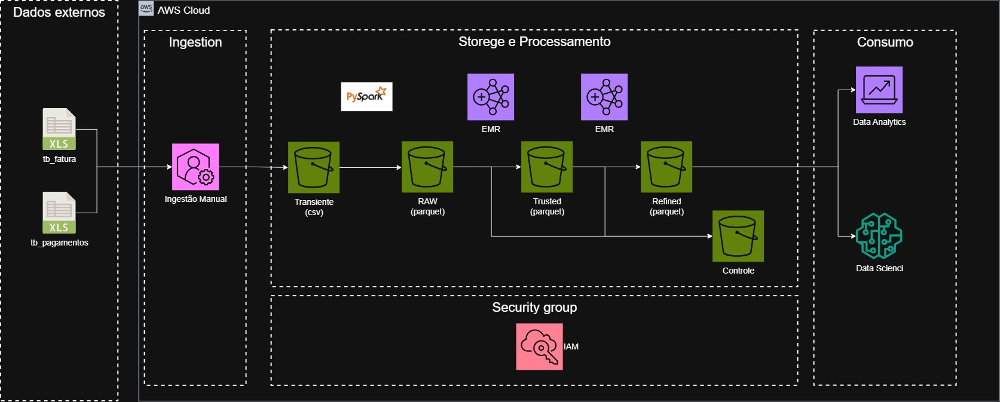

# Arquitetura e Desenvolvimento de Data Lake na AWS com Pipeline ELT para Análise de Inadimplência

## Resumo Executivo
Este repositório documenta o desenvolvimento de um Data Lake na plataforma Amazon Web Services (AWS), projetado para processar e estruturar dados financeiros de faturas e pagamentos de cartão de crédito. O projeto aplica o padrão de arquitetura ELT (Extração, Carga e Transformação) para estabelecer um ecossistema de dados escalável, cujo objetivo principal é suportar análises de inadimplência e acelerar o desenvolvimento de modelos preditivos por equipes de Data Science (criação de features/book de variáveis).

## Arquitetura do Projeto



A infraestrutura foi desenhada integralmente em nuvem, utilizando serviços gerenciados da AWS para garantir escalabilidade, segurança e alta disponibilidade:

*   **Amazon S3:** Armazenamento centralizado (Storage) para as camadas lógicas do Data Lake (Raw, Trusted, Refined e Controle).
*   **Amazon EMR / EC2:** Clusters para processamento distribuído de Big Data.
*   **AWS IAM:** Controle de acesso e segurança transversal aos serviços.
*   **Apache Spark (PySpark):** Framework central para processamento paralelo, higienização, cruzamento e agregação de dados em larga escala.

## Estrutura do Data Lake e Pipeline ELT

O fluxo de dados foi particionado nas seguintes zonas lógicas, aplicando as melhores práticas de Engenharia de Dados:

### 1. Camada Raw (Dados Brutos)
Ingestão dos arquivos transacionais originais no formato CSV (`tb_fatura` e `tb_pagamentos`). Os dados são armazenados de forma imutável, servindo como "Single Source of Truth" para recargas e auditorias.

### 2. Camada Trusted (Dados Confiáveis)
O processamento via PySpark atua na padronização dos dados brutos:
*   Conversão de tipos de dados (casting) e formatação de campos de data.
*   Gravação em formato colunar otimizado (**Parquet**).
*   Particionamento lógico baseado na data de referência (mês/ano) para viabilizar queries eficientes (schema on read) e reduzir custos de scan.
*   Criação de uma **Camada de Controle** que registra metadados de execução (data de processamento, nomenclatura e volume de registros), garantindo rastreabilidade e governança.

### 3. Camada Stage (Pré-processamento)
Atua como ponte para a camada analítica. O pipeline realiza a união (join) das bases de faturas e pagamentos e aplica regras de negócio para classificar o comportamento do cliente financeiro. As categorias geradas incluem: "Pagamento no Prazo", "Pagamento Antecipado", "Pagamento em Atraso" e "Sem Pagamento", além do cálculo exato de dias de defasagem (dias de atraso).

### 4. Camada Refined e Book de Variáveis
Fase de maior valor agregado do projeto, focada em entregar dados prontos para algoritmos de Machine Learning.
O motor do Spark processa janelas temporais dinâmicas (1, 3, 6, 9 e 12 meses) sobre a base da camada Stage. Através de agregações estatísticas (Soma, Média, Mínimo e Máximo) cruzadas com o comportamento de pagamento, o pipeline automatiza a geração de mais de 280 variáveis independentes (features) por id de cliente. A tabela final (Book) é persistida em formato Parquet para consumo rápido e escalável pelos cientistas de dados.

## Organização do Repositório

```text
├── data/
│   └── sample/                     
│       ├── tb_fatura_sample.csv
│       └── tb_pagamentos_sample.csv
├── docs/
│   └── arquitetura.jpg             
├── src/                            
│   └── notebooks/
│       ├── job_trusted_fatura.ipynb
│       ├── job_trusted_pagamentos.ipynb
│       └── job_book_variaveis.ipynb
└── README.md                       
```

## Conclusão
O desenvolvimento deste projeto demonstra a implementação prática de padrões corporativos na engenharia de dados. A estratégia de armazenamento colunar aliada ao particionamento otimiza o I/O, enquanto a estruturação automatizada de um book de variáveis comprova que o fluxo de dados não apenas trafega informação, mas atua como um pilar de inteligência, reduzindo drasticamente o tempo de preparação de dados para o desenvolvimento de modelos preditivos.